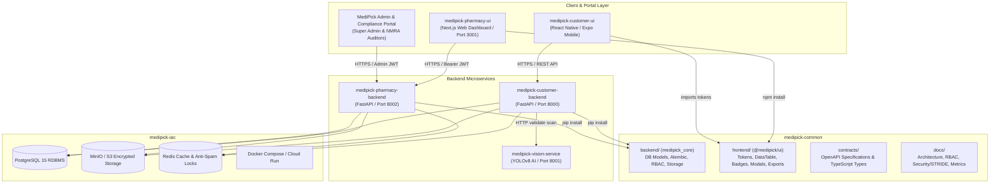
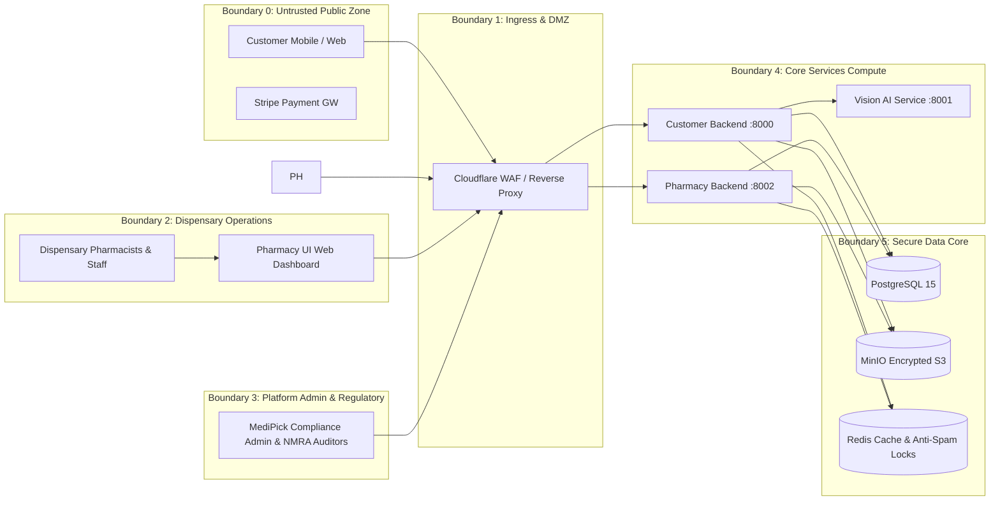

# MediPick System Architecture

MediPick is a microservice platform engineered to provide safe, audited, on-demand pharmacy dispensing across Sri Lanka in strict compliance with the **National Medicines Regulatory Authority (NMRA) Act No. 5 of 2015** and **Sri Lanka Medical Council (SLMC)** clinical custody rules.

---

## 1. System Context & Component Diagram

---

## 2. Repository Roster & Responsibilities

1. **`medipick-common`**:
   * **`backend/`**: Unified SQLAlchemy models (39 tables), Alembic migrations, RBAC matrices, Stripe payment helpers, MinIO storage manager.
   * **`frontend/`**: Shared UI design tokens, web dashboard components (DataTables, Badges, Modals, Export), and utility formatters.
   * **`contracts/`**: Centralized OpenAPI schema (`openapi.json`) and TypeScript interfaces (`types.ts`).
   * **`docs/`**: Master engineering documentation:
     * [`SECURITY_AND_STRIDE.md`](./SECURITY_AND_STRIDE.md): System Trust Boundaries, STRIDE threat model, and CVSS mitigations.
     * [`METRICS_AND_CALCULATIONS.md`](./METRICS_AND_CALCULATIONS.md): Operational formulas, statutory 90-day renewal cycle, SLA benchmarking, and analytics comparison math.
     * [`ROLES_AND_RBAC.md`](./ROLES_AND_RBAC.md): The 7 built-in dispensary staff roles, 6 canonical permissions, and SLMC custody rules.
     * [`AUTH_AND_LIFECYCLE.md`](./AUTH_AND_LIFECYCLE.md): JWT bearer lifecycle, SMS OTP verification, and session persistence.
     * [`DESIGN_SYSTEM.md`](./DESIGN_SYSTEM.md): Design tokens, card geometry, and typography standards.
2. **`medipick-customer-backend`**: Customer SMS OTP auth, drug catalog, cart management, prescription uploads, Stripe payment integration.
3. **`medipick-pharmacy-backend`**: Staff auth, multi-branch data isolation, prescription quote acceptance, inventory, SLA analytics, NMRA compliance gates, admin endpoints.
4. **`medipick-vision-service`**: YOLOv8 deep learning service for prescription NMRA seal detection, doctor signature identification, and Laplacian image sharpness scoring.
5. **`medipick-customer-ui`**: Mobile-first customer experience built with Expo and NativeWind.
6. **`medipick-pharmacy-ui`**: Next.js desktop dispensary command center with real-time kanban orders, stats analytics, compliance renewal modal, and staff roster.
7. **`medipick-iac`**: Infrastructure as Code: Docker Compose, Terraform GCP Cloud Run, and networking.
8. **`medipick-qa`**: Playwright BDD end-to-end test suite testing the full lifecycle across Customer, Vision, Pharmacy, and Counter pickup.

---

## 3. Trust Boundaries & Security Overview

For full threat analysis, CVSS impact scores, architectural countermeasures, and test verification methods, refer to [`SECURITY_AND_STRIDE.md`](./SECURITY_AND_STRIDE.md).

---

## 4. Key Architectural Patterns & Invariants

1. **Strict Multi-Branch Tenant Scoping**:
   * Every request to `medipick-pharmacy-backend` is resolved to a specific `pharmacy_id` derived directly from the authenticated JWT session.
   * Cross-branch data queries or mutations are strictly prohibited at the database query level.
2. **Statutory NMRA Annual License Gate (Section 54)**:
   * Pharmacists operate under annual retail licenses. If a license expires, the branch storefront is immediately blocked (`Storefront Inactive`).
   * Renewal submissions feature an anti-spam single in-flight lock, requiring MediPick Compliance Officer verification before storefront reactivation.
3. **Clinical Custody Verification**:
   * Only staff members with active, verified **SLMC registration numbers** (`Owner / Chief Pharmacist`, `Designated Manager / Pharmacist`, `Staff Pharmacist`) hold permission to review prescriptions and send price quotes (`canReviewRx`, `canApproveQuotes`).
4. **Physical Pickup PIN Custody**:
   * Releasing prescription orders at the dispensary counter requires validating the customer's secret 6-digit **Pickup PIN**, preventing misdispensing and fraud.
