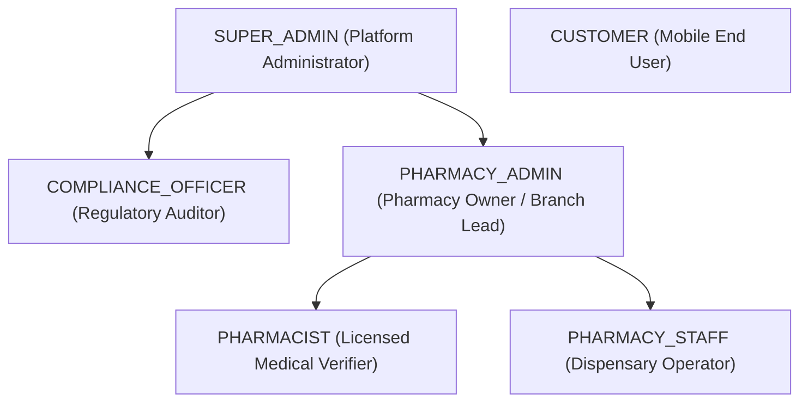

# MediPick Master Roles & RBAC Matrix

This document defines the canonical Role-Based Access Control (RBAC) architecture implemented in `medipick-common` and enforced across all MediPick microservices, mobile apps, and web portals.

---

## 1. System Roles Hierarchy

---

## 2. Canonical Role Definitions

| Role Key | Code Definition | Scope | Primary Capabilities |
| :--- | :--- | :--- | :--- |
| **`SUPER_ADMIN`** | `UserRole.SUPER_ADMIN` | Global System | Manage all registered pharmacies, platform commission rates, system users, view platform-wide revenue analytics, toggle platform feature flags. |
| **`COMPLIANCE_OFFICER`** | `UserRole.COMPLIANCE_OFFICER` | Global Regulatory | Audit all prescription verifications, inspect pharmacist NMRA/SLMC licenses, review disputed medication issues, access non-tamperable audit logs. |
| **`PHARMACY_ADMIN`** | `UserRole.PHARMACY_ADMIN` | Branch / Dispensary | Manage branch inventory, add/remove staff accounts, assign staff roles, review branch financial performance, configure operating hours and delivery radius. |
| **`PHARMACIST`** | `UserRole.PHARMACIST` | Dispensary Medical | Review and verify uploaded prescriptions, approve/reject Prescription-Only Medicines (POM), submit price quotes, verify AI seal detections. |
| **`PHARMACY_STAFF`** | `UserRole.PHARMACY_STAFF` | Dispensary Logistics | Prepare confirmed orders, update stock levels, mark orders as packed/dispensed, handle customer pickup verification. |
| **`CUSTOMER`** | `UserRole.CUSTOMER` | Individual Account | Mobile/web customer: request OTP login, search open pharmacies, order OTC medicines, upload prescriptions, track order status, submit payment via PayHere. |

---

## 3. Permissions Matrix Across Endpoints & Portals

| Resource / Action | Customer | Pharmacy Staff | Pharmacist | Pharmacy Admin | Compliance Officer | Super Admin |
| :--- | :---: | :---: | :---: | :---: | :---: | :---: |
| **Authenticate via Mobile OTP** | ✅ | ❌ | ❌ | ❌ | ❌ | ❌ |
| **Authenticate via Email/Password + JWT** | ❌ | ✅ | ✅ | ✅ | ✅ | ✅ |
| **Browse Pharmacy & OTC Catalog** | ✅ | ✅ | ✅ | ✅ | ✅ | ✅ |
| **Upload Prescription Image** | ✅ | ❌ | ❌ | ❌ | ❌ | ❌ |
| **AI Prescription Clarity & Seal Check** | Triggered | View | View | View | Full Audit | Full Audit |
| **Accept/Reject Prescription & Send Quote** | ❌ | ❌ | ✅ | ✅ | ❌ | ❌ |
| **Update Stock & Allocate Medicine** | ❌ | ✅ | ✅ | ✅ | ❌ | ✅ |
| **Mark Order DISPENSED / COMPLETED** | ❌ | ✅ | ✅ | ✅ | ❌ | ✅ |
| **Initiate PayHere Checkout** | ✅ | ❌ | ❌ | ❌ | ❌ | ❌ |
| **Access Financials & Revenue Stats** | ❌ | ❌ | Branch | Branch Full | Read-Only | Platform Full |
| **Manage Staff Accounts & Invites** | ❌ | ❌ | ❌ | ✅ | ❌ | ✅ |
| **Inspect System Audit Logs** | ❌ | ❌ | ❌ | ❌ | ✅ | ✅ |
| **Approve / Suspend Pharmacy Licenses** | ❌ | ❌ | ❌ | ❌ | ✅ | ✅ |

---

## 4. Enforcement Strategy

1. **Backend Layer:**
   * Python decorator: `@require_role(UserRole.SUPER_ADMIN, UserRole.COMPLIANCE_OFFICER)` in `medipick_core.rbac`.
   * Multi-branch tenancy isolation enforced via `pharmacy_id` foreign key assertions on all DB queries.
2. **Frontend Layer:**
   * React component: `<AuthGuard allowedRoles={['SUPER_ADMIN', 'COMPLIANCE_OFFICER']}>` in `@medipick/ui/auth`.
