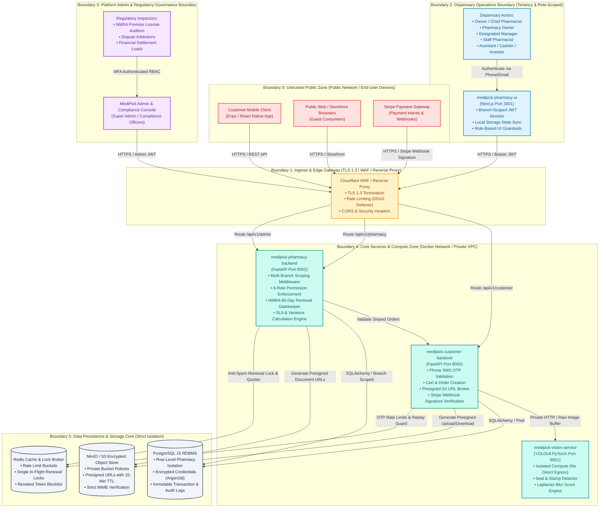

# MediPick Security Architecture, Trust Boundaries & STRIDE Threat Model

> **Status:** Approved Architecture & Threat Analysis  
> **Applies to:** `medipick-customer-ui`, `medipick-pharmacy-ui`, `medipick-customer-backend`, `medipick-pharmacy-backend`, `medipick-vision-service`, `medipick-common`, `medipick-iac`  
> **Regulatory Foundations:** National Medicines Regulatory Authority (NMRA) Act No. 5 of 2015, Sri Lanka Medical Council (SLMC) Guidelines, Personal Data Protection Act (PDPA) No. 9 of 2022.

---

## 1. System Trust Boundaries Diagram

The following diagram maps the network segments, trust tiers, data flow barriers, and authorization checkpoints across MediPick. It includes the **Customer Client**, **Dispensary Operations**, **Platform Admin & Compliance Oversight**, **Core Microservices**, and **Secure Persistence**.

---

## 2. Description of Trust Boundaries

| Boundary Identifier | Zone Name | Trust Level | Security Guarantees & Enforcement |
| :--- | :--- | :--- | :--- |
| **TB0** | **Untrusted Public Zone** | **Zero Trust** | All customer devices, browsers, and external payment gateways. Assumed to be potentially compromised, jailbroken, or transmitting intercepted traffic. Every inbound payload is strictly validated, sanitized, and authenticated. |
| **TB1** | **Ingress & Edge Gateway** | **Perimeter Defense** | Public IP to Private IP translation. TLS 1.3 encryption in transit, Cloudflare WAF DDoS mitigation, Geo-IP filtering, IP-based burst rate limiting, and standard security headers (`HSTS`, `CSP`, `X-Frame-Options: DENY`). |
| **TB2** | **Dispensary Boundary** | **Authenticated Staff** | Pharmacy staff operating the desktop portal (`medipick-pharmacy-ui`). Access is gated by JWT bearer tokens carrying `pharmacy_id` and `staff_role`. Data is constrained strictly to the staff member's assigned physical branch. |
| **TB3** | **Platform Admin & Regulatory Boundary** | **Privileged Oversight** | MediPick Compliance Officers and NMRA statutory auditors. Access requires elevated privileges, IP restriction, and mandatory 2FA. Controls premise licensing approvals, audit log extractions, dispute overrides, and financial ledger settlements. |
| **TB4** | **Core Microservices Zone** | **Internal VPC / Isolated** | Docker bridge network (`medipick-network`). Services communicate over private DNS names (`http://medipick-backend:8000`, `http://medipick-vision:8001`, `http://medipick-pharmacy-backend:8002`). Ports 8000/8001/8002 are never bound directly to public 0.0.0.0 without WAF proxying. |
| **TB5** | **Data Persistence Core** | **Highly Confidential** | Relational databases and object storage. Database credentials are encrypted and injected via environment variables. Prescriptions and compliance certificates stored in MinIO are private by default; access is granted exclusively through short-lived presigned URLs (15-minute TTL). |

---

## 3. STRIDE Threat Modeling Matrix

The STRIDE model categorizes computer security threats into six distinct areas: **S**poofing, **T**ampering, **R**epudiation, **I**nformation Disclosure, **D**enial of Service, and **E**levation of Privilege.

| Threat ID | STRIDE Category | Target Asset / Boundary | Threat Scenario & Attack Vector | Impact / Severity | Architecture Countermeasures & Mitigations | Verification & Test Method |
| :---: | :---: | :---: | :--- | :---: | :--- | :--- |
| **S-01** | **Spoofing** | Customer Identity (TB0 &rarr; TB4) | Attacker attempts to spoof a customer's phone number to hijack active prescriptions, view order history, or accept quotes. | **HIGH** | • SMS OTP with cryptographically random 6-digit codes. • 3-minute code expiration. • Max 3 failed attempts before lockouts. • Replay protection via Redis nonce cache. | `test_customer_otp_replay_blocked` / BDD scenario `customer_auth.feature` |
| **S-02** | **Spoofing** | Pharmacist Credential (TB2 &rarr; TB4) | Malicious actor registers a fake dispensary or claims a licensed SLMC pharmacist identity to dispense prescription drugs illegally. | **CRITICAL** | • Mandatory SLMC registration verification against national roster. • Verification status defaults to `pending_submission` / `under_review`. • Storefront remains inactive until MediPick Compliance Officer validates physical certificate. | Unit test `test_slmc_custody_validation` in `medipick_core` |
| **S-03** | **Spoofing** | Payment Webhook (TB0 &rarr; TB4) | Attacker crafts a forged HTTP POST request simulating Stripe payment confirmation (`payment_intent.succeeded`) to release orders without payment. | **CRITICAL** | • Stripe Webhook signature verification (`stripe.Webhook.construct_event` / HMAC-SHA256 with `STRIPE_WEBHOOK_SECRET`). • Timestamp replay tolerance check (within 300s). • Fail-closed configuration check (dev secrets rejected in staging/production). • Webhook idempotent transaction lock (`txn.status in (SUCCEEDED, REFUNDED)` guard). | BDD scenario `payment_tamper_blocked` in `medipick-qa` |
| **T-01** | **Tampering** | Prescription Image (TB0 &rarr; TB4) | Customer or rogue actor submits an altered digital prescription image (e.g. forged drug quantity, tampered doctor signature). | **HIGH** | • YOLOv8 deep learning vision service detects valid NMRA doctor stamps. • Laplacian variance calculates edge sharpness score to detect blurred/altered scans. • Licensed Pharmacist (`canReviewRx`) must manually review and certify original image before issuing quote. | `test_vision_sharpness_scoring` in `medipick-vision-service` |
| **T-02** | **Tampering** | Quote Pricing & Quantities (TB2 &rarr; TB4) | Rogue staff member attempts to tamper with quote unit prices or apply unauthorized discounts beyond allowable branch limits. | **HIGH** | • Server-side quote pricing calculation against immutable master catalog. • Max allowable discount rate enforced in `medipick_core` service layer. • Only `canApproveQuotes` role permission can sign and transmit quotes. | `test_quote_discount_ceiling` in `medipick-pharmacy-backend` |
| **T-03** | **Tampering** | NMRA Renewal Dates (TB2 &rarr; TB4) | Pharmacy owner alters client-side date picker payload to submit past dates or falsify statutory expiration dates to bypass the 90-day gate. | **HIGH** | • Server-side statutory validation: expiration date must be strictly in the future (`expiry_date > today`). • Annual cycle validation helper (+1 statutory year). • Status remains `pending_review` with upload locked until Admin signs off. | BDD scenario `nmra_date_picker_validation` |
| **T-04** | **Tampering** | Multi-Branch Tenancy (TB2 &rarr; TB5) | Staff member at Branch A submits SQL injection or modifies `branch_id` in request body to mutate inventory or orders belonging to Branch B. | **CRITICAL** | • Strict tenancy middleware binds session from JWT claims, ignoring client payload `branch_id`. • SQLAlchemy ORM parameterized queries eliminate SQL injection. • Row-level filtering enforced on all queries (`where pharmacy_id == current_branch_id`). | `test_cross_branch_data_isolation` in `medipick-pharmacy-backend` |
| **R-01** | **Repudiation** | Prescription Quote Issuance (TB2 &rarr; TB3) | Pharmacist denies sending an incorrect medication quote or pricing mistake after customer disputes the order. | **MEDIUM** | • Immutable quote record generated with `quoted_by_user_id`, timestamp, and full line item breakdown. • Immutable record stored in `quotes` table; cannot be updated or deleted post-issuance. | Audit trail verification in `ComplianceView.tsx` |
| **R-02** | **Repudiation** | Counter Medication Pickup (TB0 &rarr; TB2) | Customer picks up POM medication at the counter and later claims they never received it, demanding a refund. | **HIGH** | • Physical custody transfer requires customer to present their unique 6-digit **Pickup PIN**. • Cashier enters PIN into portal &rarr; backend validates against cryptographically hashed PIN. • Timestamp, cashier user ID, and pickup event logged immutably. | BDD scenario `order_pickup_pin_custody` in `medipick-qa` |
| **R-03** | **Repudiation** | License Renewal Approvals (TB3 &rarr; Regulatory) | Compliance Administrator denies approving an unverified pharmacy license following an NMRA inspection violation. | **HIGH** | • Administrative audit trail logs `verified_by_user_id` and `verified_at` timestamp in `pharmacy_licenses`. • Audit logs are append-only and exported for NMRA statutory inspection. | Audit log export verification in `ComplianceView.tsx` |
| **I-01** | **Information Disclosure** | Prescription Health Records (TB4 &rarr; TB0) | Malicious user guesses sequential file URLs or IDs to download confidential prescription scans and doctor diagnoses. | **CRITICAL** | • Prescriptions stored in private MinIO bucket with no public read permissions. • Access strictly via presigned URLs with 15-minute TTL. • URL generation requires valid JWT for either the owning customer or assigned dispensary branch. | `test_presigned_url_auth_barrier` in `medipick_core` |
| **I-02** | **Information Disclosure** | Dispensary Banking & Revenue (TB2 &rarr; TB2) | Junior dispensary assistant or cashier accesses financial analytics, total gross revenue, and bank settlement details. | **HIGH** | • Explicit RBAC gate: `canViewFinancials` required. • API returns `403 FORBIDDEN` for unauthorized roles. • Frontend hides Revenue tabs, Settlement Ledgers, and GMV cards for non-financial roles. | BDD scenario `pharmacy_rbac_financial_guard` |
| **I-03** | **Information Disclosure** | Branch Network Leakage (TB2 &rarr; TB2) | Non-owner staff member accesses corporate earnings across other branch outlets or switches active branch context. | **HIGH** | • Only `is_owner` roles (`Owner / Chief Pharmacist` and `Pharmacy Owner`) hold cross-branch switcher permissions. • Staff tokens are scoped strictly to individual branch UUID. | `test_staff_branch_switching_blocked` |
| **D-01** | **Denial of Service** | OCR Vision Service CPU Exhaustion (TB4 &rarr; TB4) | Attacker uploads thousands of 50MB image files simultaneously to exhaust PyTorch YOLOv8 compute resources. | **HIGH** | • Client and gateway max file size limit (10MB). • Allowed MIME types strictly restricted (`image/jpeg`, `image/png`, `application/pdf`). • Redis rate limit bucket per customer IP/Phone. • Vision service runs in dedicated container with CPU/Memory limits. | `test_vision_upload_size_limit` |
| **D-02** | **Denial of Service** | License Renewal Spam Flooding (TB2 &rarr; TB4) | Disgruntled pharmacy employee spams file uploads on NMRA renewal dialog to exhaust compliance officer review queue. | **MEDIUM** | • **Single in-flight verification lock**: Only one pending renewal certificate allowed at a time per branch. • Additional submissions locked until current submission is approved or rejected. • Upload button disables with `Locked · Review Pending` status. | Playwright test `compliance_premises_gate.png` |
| **D-03** | **Denial of Service** | SMS Gateway Exhaustion (TB0 &rarr; TB1) | Attacker loops OTP generation endpoint to deplete MediPick's SMS provider credits and block legitimate customer logins. | **HIGH** | • Exponential backoff on OTP resend requests (60s cooldown). • IP-based rate limiting (max 5 OTP requests per hour per IP). • Webhook captcha challenge triggered upon abnormal traffic detection. | Unit test `test_otp_rate_limiting` |
| **E-01** | **Elevation of Privilege** | Assistant Approving Prescriptions (TB2 &rarr; TB4) | Dispensary assistant calls `POST /api/v1/orders/{id}/quote` directly to bypass pharmacist clinical verification. | **CRITICAL** | • Backend endpoint enforces `canApproveQuotes` and `canReviewRx`. • Rejects request with `403 INSUFFICIENT_PERMISSIONS`. • NMRA statutory compliance mandates SLMC registration for clinical sign-off. | Unit test `test_assistant_quote_approval_rejected` in `medipick-pharmacy-backend` |
| **E-02** | **Elevation of Privilege** | Customer Escalating to Staff (TB0 &rarr; TB4) | Customer passes their customer JWT token to dispensary endpoints (`/api/v1/pharmacy/...`). | **CRITICAL** | • Token role claim inspection: `role` must be `PHARMACY_STAFF` or `PHARMACY_ADMIN`. • Customer tokens immediately rejected with `403 FORBIDDEN_ROLE`. | `test_customer_token_on_pharmacy_endpoint` |
| **E-03** | **Elevation of Privilege** | Staff Escalating to Platform Admin (TB2 &rarr; TB3) | Pharmacy owner calls compliance approval API (`POST /api/v1/admin/licenses/verify`) to self-approve their expired license. | **CRITICAL** | • Admin endpoints reside behind dedicated `AdminGuard` requiring `SUPER_ADMIN` or `COMPLIANCE_OFFICER` roles. • Pharmacy staff tokens lack admin claims and are rejected with `401/403`. | `test_admin_endpoint_authorization` |

---

## 4. Platform Admin & Compliance Governance Tier

The **Platform Admin Tier** enforces state and statutory regulations across all registered dispensary branches:

1. **NMRA Statutory Premise Verification Workflow**:
   * Retail pharmacies must hold a valid annual premise license pursuant to **Section 54 of NMRA Act No. 5 of 2015**.
   * When an annual renewal is due within **90 days**, a statutory grace period alert is activated in the dispensary dashboard.
   * If the expiration date passes without a verified renewal, the branch storefront is immediately marked **`INACTIVE`**—counter and online POM dispensing is blocked.
   * The pharmacy submits their renewed license and validity date via the renewal modal &rarr; enters `pending_review` with an anti-spam single in-flight lock.
   * A MediPick Compliance Officer reviews the physical certificate file and statutory expiration date, clicking **Approve** or **Reject** with reasons.
   * Upon Admin approval, the premise license is marked `VERIFIED`, and the storefront is automatically reactivated.

2. **Immutable Audit Trail Exports**:
   * Every compliance action, stock movement, clinical quote, and financial payout is recorded in PostgreSQL with actor IDs and UTC timestamps.
   * Dispensary managers and compliance officers can export structured audit records in **CSV** or **JSON** for statutory NMRA inspections.

3. **Dispute Resolution & Clinical Custody Verification**:
   * Compliance officers possess read-only audit access to prescription files, clarity scores, quote breakdowns, and delivery logs to arbitrate customer disputes.
   * Every branch must maintain at least one active **Custody Pharmacist** with a verified SLMC registration number. Any deactivation that leaves a branch without a custody pharmacist is rejected.

---

## 5. Data Privacy & Health Information Compliance (PDPA / NMRA)

MediPick adheres to the Sri Lanka **Personal Data Protection Act (PDPA) No. 9 of 2022**:

* **Data Minimization**: Only information medically necessary to prepare and dispense prescription quotes is requested from customers.
* **Prescription Confidentiality**: Prescriptions are encrypted at rest (AES-256) and in transit (TLS 1.3). Direct public access to S3 object keys is prohibited.
* **Role-Based Access Partitioning**: Dispensary Assistants and Cashiers cannot view medical notes or prescription images beyond picking item names and quantities.
* **Session Security**: Storage tokens stored in client browsers (`localStorage`) are bound to short-lived JWTs (1 hour) with refresh rotation. Logging out immediately invalidates cached session state and clears all local tokens.

---

## 6. Implemented Application & Infrastructure Hardenings

1. **Mock Payment Environment Guard**:
   * Endpoint `POST /api/v1/payments/mock-confirm` is strictly restricted to `development`, `test`, and `dev` environments. If invoked in staging or production, it returns `404 NOT_FOUND` immediately, preventing uncharged order releases.
2. **Fail-Closed Payment Webhook Secret**:
   * `verify_webhook_signature` requires an explicit, non-default `PAYMENT_WEBHOOK_SECRET` in non-development environments, preventing forged webhook requests using default keys.
3. **Reverse-Proxy Client IP Resolution**:
   * Both `customer-backend` and `pharmacy-backend` rate limiters inspect `CF-Connecting-IP` and `X-Forwarded-For` headers prior to socket fallback, preventing reverse proxy IP clustering and ensuring fair, accurate rate limit buckets per user.
4. **Vision Service Perimeter Isolation**:
   * Docker Compose configs bind the YOLOv8 vision service port strictly to `127.0.0.1` (loopback), preventing LAN or public exposure.
   * Terraform GCP Cloud Run configuration sets `ingress = "INGRESS_TRAFFIC_INTERNAL_ONLY"` so the vision service is never exposed to public internet traffic.
5. **Database Transport Encryption (SSL Support)**:
   * SQLAlchemy asyncpg engine supports `DATABASE_SSL=require`, ensuring cloud PostgreSQL traffic over remote networks is encrypted with TLS.
